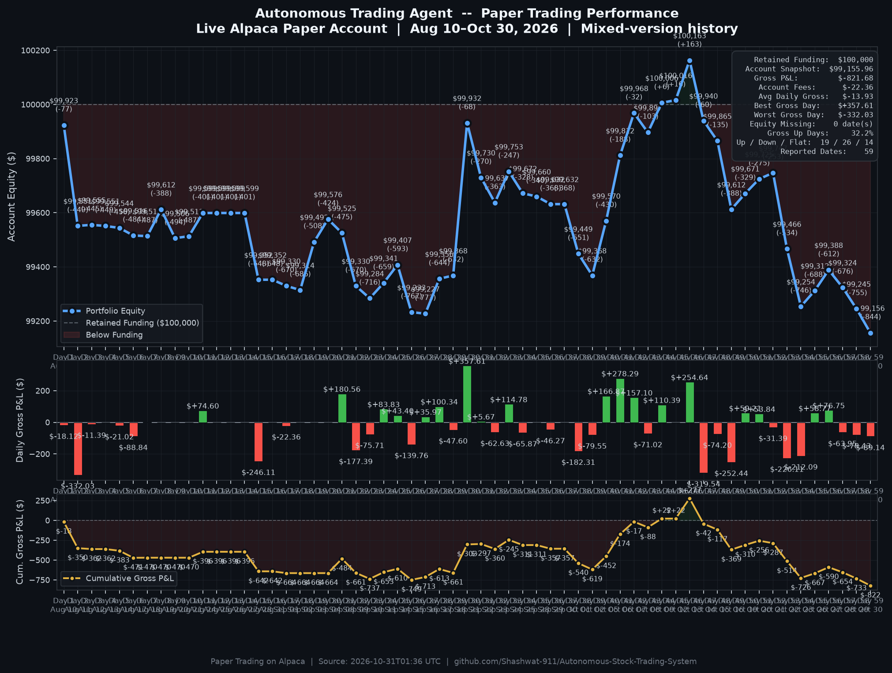
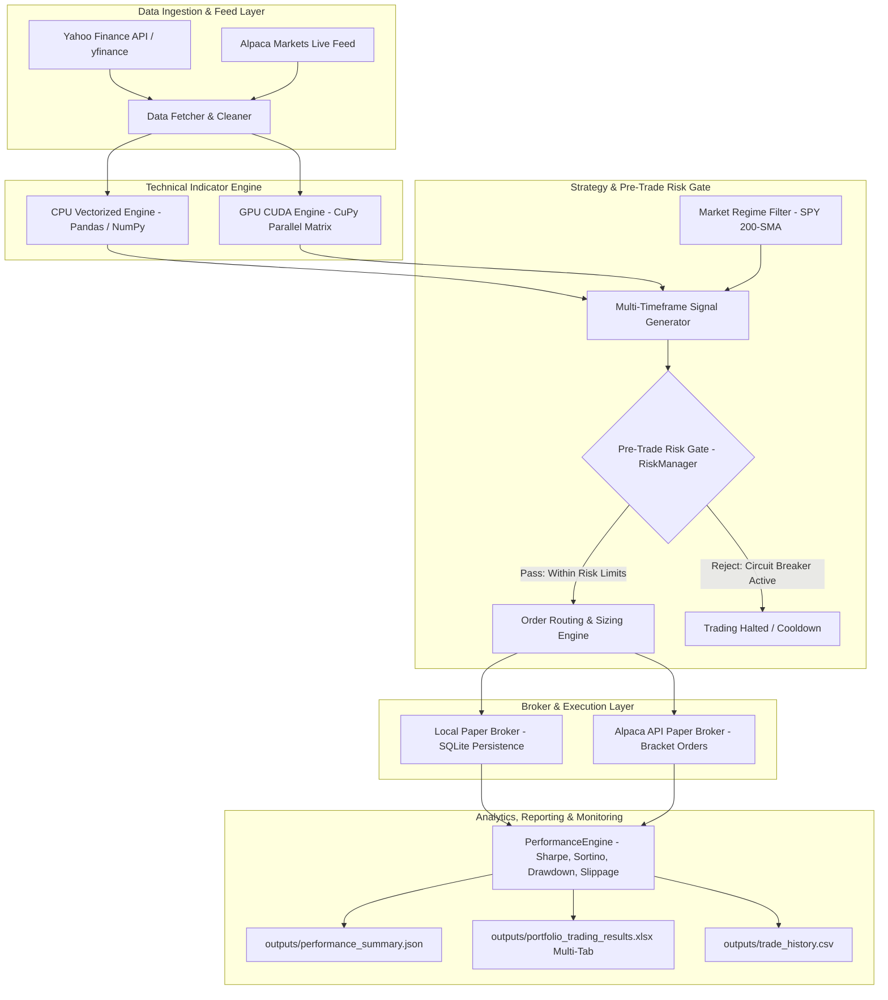

# Autonomous Stock Trading System

A Python system for multi-asset paper trading, risk-controlled execution, and quantitative backtesting.

**Stack:** Python · Pandas / NumPy · Alpaca API · SQLite · CuPy (optional)

[Service status](https://autonomous-stock-trader.onrender.com/) · [Session logs](https://autonomous-stock-trader.onrender.com/logs)

## Engineering highlights

- **Signal engine:** multi-timeframe technical indicators and a broad-market regime filter.
- **Risk controls:** ATR position sizing, exposure limits, loss circuit breakers, and bracket orders.
- **Research workflow:** historical backtests, rolling walk-forward evaluation, and performance reports.
- **Execution & monitoring:** local/Alpaca paper brokers, persistent trade records, and automated session reporting.

## Paper trading performance



<!-- MEASUREMENT_V2_START -->
## Corrected account measurement

Mixed-version account history; **not a validated baseline for the current strategy**.
The earlier unverified session table is archived in docs/LEGACY_SESSION_TABLE.md.

Period: 2026-08-09 through 2026-10-30 (New York dates).
Source retrieved: 2026-10-31T01:36:47.947490+00:00. Report generated: 2026-10-31T01:36:50.358851+00:00.

Completed flat-to-flat episodes: **405**; gross win rate: **41.23%**.
Gross expectancy: **$-2.03**. Fees are unallocated account-level costs, excluded from trade metrics.

Latest account snapshot: **$99,155.96** at 2026-10-31T01:36:47.947490+00:00 (separate from daily history).

[Measurement definitions and limitations](docs/MEASUREMENT_V2.md)
<!-- MEASUREMENT_V2_END -->

### Daily Session Breakdown

<details>
<summary>View daily account history and session logs</summary>

Validated account measurements (mixed strategy versions). Realized P&L excludes fees and open-position P&L.

| Day | Date (New York) | Broker equity | Gross realized P&L | Cumulative gross realized | Equity change | Session log |
|---:|---|---:|---:|---:|---:|---|
| 1 | 2026-08-10 | $99,923.23 | $-18.12 | $-18.12 | $-76.77 | Not archived |
| 2 | 2026-08-11 | $99,551.43 | $-332.03 | $-350.15 | $-371.80 | Not archived |
| 3 | 2026-08-12 | $99,555.06 | $-11.39 | $-361.54 | $3.63 | Not archived |
| 4 | 2026-08-13 | $99,551.03 | $0.00 | $-361.54 | $-4.03 | Not archived |
| 5 | 2026-08-14 | $99,543.69 | $-21.02 | $-382.56 | $-7.34 | Not archived |
| 6 | 2026-08-17 | $99,515.93 | $-88.84 | $-471.40 | $-27.76 | Not archived |
| 7 | 2026-08-18 | $99,513.39 | $0.97 | $-470.43 | $-2.54 | Not archived |
| 8 | 2026-08-19 | $99,612.24 | $0.00 | $-470.43 | $98.85 | Not archived |
| 9 | 2026-08-20 | $99,506.06 | $0.00 | $-470.43 | $-106.18 | [Log](outputs/logs/session_2026_08_20.txt) |
| 10 | 2026-08-21 | $99,513.11 | $0.00 | $-470.43 | $7.05 | [Log](outputs/logs/session_2026_08_21.txt) |
| 11 | 2026-08-24 | $99,598.94 | $74.60 | $-395.83 | $85.83 | [Log](outputs/logs/session_2026_08_24.txt) |
| 12 | 2026-08-25 | $99,598.94 | $0.00 | $-395.83 | $0.00 | [Log](outputs/logs/session_2026_08_25.txt) |
| 13 | 2026-08-26 | $99,598.94 | $0.00 | $-395.83 | $0.00 | [Log](outputs/logs/session_2026_08_26.txt) |
| 14 | 2026-08-27 | $99,598.94 | $0.00 | $-395.83 | $0.00 | [Log](outputs/logs/session_2026_08_27.txt) |
| 15 | 2026-08-28 | $99,352.40 | $-246.11 | $-641.94 | $-246.54 | [Log](outputs/logs/session_2026_08_28.txt) |
| 16 | 2026-08-31 | $99,352.40 | $0.00 | $-641.94 | $0.00 | [Log](outputs/logs/session_2026_08_31.txt) |
| 17 | 2026-09-01 | $99,329.81 | $-22.36 | $-664.30 | $-22.59 | [Log](outputs/logs/session_2026_09_01.txt) |
| 18 | 2026-09-02 | $99,314.21 | $0.00 | $-664.30 | $-15.60 | [Log](outputs/logs/session_2026_09_02.txt) |
| 19 | 2026-09-03 | $99,491.97 | $0.00 | $-664.30 | $177.76 | [Log](outputs/logs/session_2026_09_03.txt) |
| 20 | 2026-09-04 | $99,576.01 | $0.00 | $-664.30 | $84.04 | [Log](outputs/logs/session_2026_09_04.txt) |
| 21 | 2026-09-08 | $99,524.99 | $180.56 | $-483.74 | $-51.02 | [Log](outputs/logs/session_2026_09_08.txt) |
| 22 | 2026-09-09 | $99,329.57 | $-177.39 | $-661.13 | $-195.42 | [Log](outputs/logs/session_2026_09_09.txt) |
| 23 | 2026-09-10 | $99,283.72 | $-75.71 | $-736.84 | $-45.85 | [Log](outputs/logs/session_2026_09_10.txt) |
| 24 | 2026-09-11 | $99,340.55 | $83.83 | $-653.01 | $56.83 | [Log](outputs/logs/session_2026_09_11.txt) |
| 25 | 2026-09-14 | $99,407.39 | $43.40 | $-609.61 | $66.84 | [Log](outputs/logs/session_2026_09_14.txt) |
| 26 | 2026-09-15 | $99,232.51 | $-139.76 | $-749.37 | $-174.88 | [Log](outputs/logs/session_2026_09_15.txt) |
| 27 | 2026-09-16 | $99,227.05 | $35.97 | $-713.40 | $-5.46 | [Log](outputs/logs/session_2026_09_16.txt) |
| 28 | 2026-09-17 | $99,355.76 | $100.34 | $-613.06 | $128.71 | [Log](outputs/logs/session_2026_09_17.txt) |
| 29 | 2026-09-18 | $99,368.13 | $-47.60 | $-660.66 | $12.37 | [Log](outputs/logs/session_2026_09_18.txt) |
| 30 | 2026-09-21 | $99,931.88 | $357.61 | $-303.05 | $563.75 | [Log](outputs/logs/session_2026_09_21.txt) |
| 31 | 2026-09-22 | $99,730.01 | $5.67 | $-297.38 | $-201.87 | [Log](outputs/logs/session_2026_09_22.txt) |
| 32 | 2026-09-23 | $99,637.15 | $-62.63 | $-360.01 | $-92.86 | [Log](outputs/logs/session_2026_09_23.txt) |
| 33 | 2026-09-24 | $99,752.52 | $114.78 | $-245.23 | $115.37 | [Log](outputs/logs/session_2026_09_24.txt) |
| 34 | 2026-09-25 | $99,671.92 | $-65.87 | $-311.10 | $-80.60 | [Log](outputs/logs/session_2026_09_25.txt) |
| 35 | 2026-09-28 | $99,659.89 | $0.00 | $-311.10 | $-12.03 | [Log](outputs/logs/session_2026_09_28.txt) |
| 36 | 2026-09-29 | $99,631.71 | $-46.27 | $-357.37 | $-28.18 | [Log](outputs/logs/session_2026_09_29.txt) |
| 37 | 2026-09-30 | $99,631.71 | $0.00 | $-357.37 | $0.00 | [Log](outputs/logs/session_2026_09_30.txt) |
| 38 | 2026-10-01 | $99,448.51 | $-182.31 | $-539.68 | $-183.20 | [Log](outputs/logs/session_2026_10_01.txt) |
| 39 | 2026-10-02 | $99,368.26 | $-79.55 | $-619.23 | $-80.25 | [Log](outputs/logs/session_2026_10_02.txt) |
| 40 | 2026-10-05 | $99,570.30 | $166.87 | $-452.36 | $202.04 | [Log](outputs/logs/session_2026_10_05.txt) |
| 41 | 2026-10-06 | $99,811.65 | $278.29 | $-174.07 | $241.35 | [Log](outputs/logs/session_2026_10_06.txt) |
| 42 | 2026-10-07 | $99,968.05 | $157.10 | $-16.97 | $156.40 | [Log](outputs/logs/session_2026_10_07.txt) |
| 43 | 2026-10-08 | $99,896.56 | $-71.02 | $-87.99 | $-71.49 | [Log](outputs/logs/session_2026_10_08.txt) |
| 44 | 2026-10-09 | $100,006.19 | $110.39 | $22.40 | $109.63 | [Log](outputs/logs/session_2026_10_09.txt) |
| 45 | 2026-10-12 | $100,015.93 | $0.00 | $22.40 | $9.74 | [Log](outputs/logs/session_2026_10_12.txt) |
| 46 | 2026-10-13 | $100,163.21 | $254.64 | $277.04 | $147.28 | [Log](outputs/logs/session_2026_10_13.txt) |
| 47 | 2026-10-14 | $99,939.87 | $-319.54 | $-42.50 | $-223.34 | [Log](outputs/logs/session_2026_10_14.txt) |
| 48 | 2026-10-15 | $99,865.37 | $-74.20 | $-116.70 | $-74.50 | [Log](outputs/logs/session_2026_10_15.txt) |
| 49 | 2026-10-16 | $99,612.27 | $-252.44 | $-369.14 | $-253.10 | [Log](outputs/logs/session_2026_10_16.txt) |
| 50 | 2026-10-19 | $99,671.00 | $59.21 | $-309.93 | $58.73 | [Log](outputs/logs/session_2026_10_19.txt) |
| 51 | 2026-10-20 | $99,724.53 | $53.84 | $-256.09 | $53.53 | [Log](outputs/logs/session_2026_10_20.txt) |
| 52 | 2026-10-21 | $99,747.20 | $-31.39 | $-287.48 | $22.67 | [Log](outputs/logs/session_2026_10_21.txt) |
| 53 | 2026-10-22 | $99,466.38 | $-226.11 | $-513.59 | $-280.82 | [Log](outputs/logs/session_2026_10_22.txt) |
| 54 | 2026-10-23 | $99,253.69 | $-212.09 | $-725.68 | $-212.69 | [Log](outputs/logs/session_2026_10_23.txt) |
| 55 | 2026-10-26 | $99,312.16 | $58.77 | $-666.91 | $58.47 | [Log](outputs/logs/session_2026_10_26.txt) |
| 56 | 2026-10-27 | $99,388.49 | $76.75 | $-590.16 | $76.33 | [Log](outputs/logs/session_2026_10_27.txt) |
| 57 | 2026-10-28 | $99,323.95 | $-63.95 | $-654.11 | $-64.54 | [Log](outputs/logs/session_2026_10_28.txt) |
| 58 | 2026-10-29 | $99,245.10 | $-78.43 | $-732.54 | $-78.85 | [Log](outputs/logs/session_2026_10_29.txt) |
| 59 | 2026-10-30 | $99,155.96 | $-89.14 | $-821.68 | $-89.14 | [Log](outputs/logs/session_2026_10_30.txt) |

[Archived legacy table — unverified](docs/LEGACY_SESSION_TABLE.md). Missing equity is never estimated from the current account snapshot.

</details>

---

## Architecture

<details>
<summary>View system architecture</summary>



</details>

## Run locally

Install Python 3.10+ dependencies from the repository root:

```bash
pip install -r requirements.txt
python main.py backtest
python main.py walkforward
```

For Alpaca paper execution, copy `.env.example` to `.env`, configure your paper-account credentials, review `config.py`, and run `python main.py live`.

[Configuration](config.py) · [Research guide](research/README.md) · [Measurement methodology](docs/MEASUREMENT_V2.md)

Paper-trading results are simulated and do not establish future profitability.
